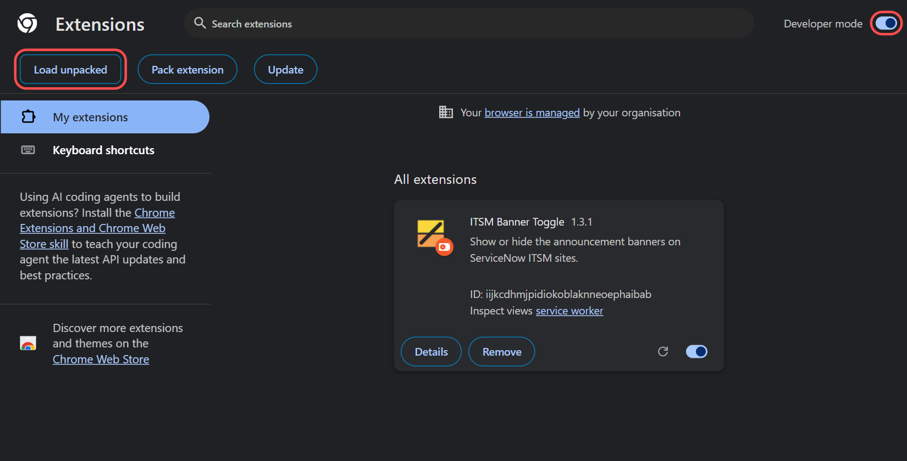
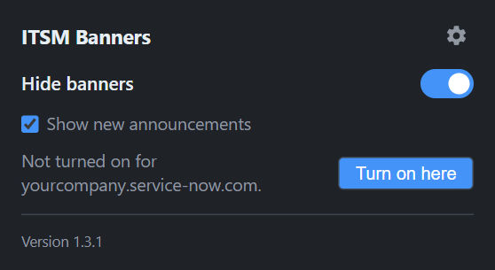
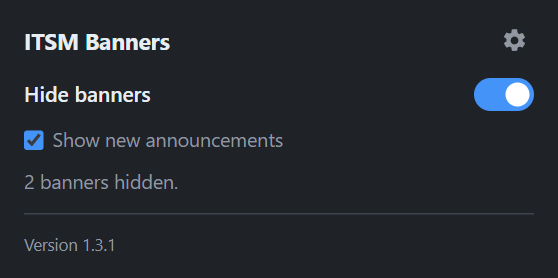
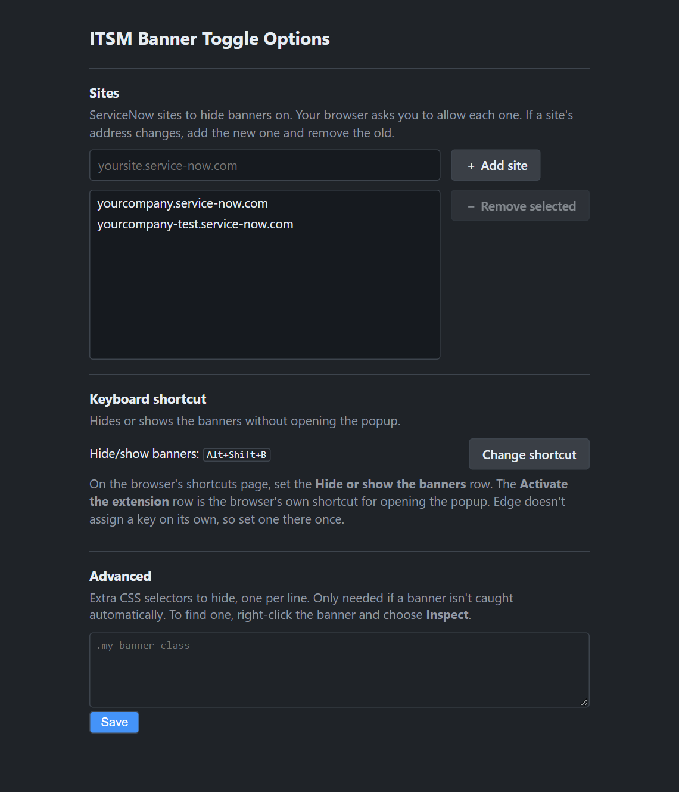

# ITSM Banner Toggle

A Chrome / Edge extension (Manifest V3) that shows or hides the announcement banners on
ServiceNow ITSM sites, such as notices about upcoming upgrades, hotfixes and change
freezes. Click the toolbar icon and use the switch. No site is built in: you choose which
ServiceNow sites it runs on, such as `yourcompany.service-now.com`.

## Install (unpacked)

1. **Get the files.** Download the zip from the latest
   [release](https://github.com/wsimps6i/itsm-banner-toggle/releases/latest) and extract it
   to a folder you'll keep, such as `Documents\ITSM Banner Toggle`. The browser loads the
   extension from that folder every time it starts, so don't delete or move it afterwards.

2. **Turn on Developer mode and load the folder.** In Chrome, go to `chrome://extensions`.
   Switch on **Developer mode** (top right), click **Load unpacked** (top left) and select
   the folder. In Edge it's the same at `edge://extensions`, where the **Developer mode**
   switch is in the left pane.

   

   The **ITSM Banner Toggle** card appears once it's loaded. Click the puzzle-piece icon in
   the toolbar and pin the extension so the switch is one click away.

3. **Turn it on for your ServiceNow site.** Open the site, click the extension's icon, click
   **Turn on here**, and allow access when the browser asks. Banners already on the page are
   hidden straight away. Do the same for any other ServiceNow site you use.

   

Settings are stored in `chrome.storage.sync`, so they follow your browser profile. Banners
are hidden by default.

To update, extract the new zip over the same folder, then click the reload icon on the
extension's card on the extensions page.

## Using it

- **Hide banners** switch: hides or shows the banners. **Alt+Shift+B** does the same from
  the keyboard in Chrome. Edge doesn't assign that key, so set one there. To set or change
  it, click **Change shortcut** under **Keyboard shortcut** on the Options page, and set the
  **Hide or show the banners** row. The **Activate the extension** row is the
  browser's own shortcut for opening the popup.
- **New announcements show up anyway.** The extension remembers the banners you've hidden.
  When ServiceNow posts a banner with new text, it's shown until you click **Hide it** in
  the popup (or flip the switch off and on). To hide everything regardless, untick
  **Show new announcements**.
- **Toolbar badge:** a number means that many banners are hidden on this tab. **NEW** means
  a new banner is showing, and **OFF** means banners aren't being hidden.
- **Options page:** the gear icon at the top right of the popup opens the Options page in a
  new tab. It holds the **Sites** list, the **Keyboard shortcut** and the **Advanced**
  custom selectors. You can also reach it from **Extension options** on the extension's
  card on the extensions page.

  

- **Sites:** on a ServiceNow site, open the popup and click **Turn on here**. You can also
  type the address under **Sites** on the Options page and click **Add site** (or press
  Enter). The browser asks you to allow the extension on that site, and it starts working
  straight away; banners already there are hidden. To turn sites off, select them in the
  list (Ctrl-click or Shift-click for several) and click **Remove selected**, then reload
  any open tabs on those sites to bring their banners back. If a site's address changes,
  add the new one and remove the old. Settings such as the switch apply to every site.

## How it works

`content.js` runs on the sites you've added. It looks for elements whose tag, id or class contains
"announcement", in the normal page and inside the Next Experience shadow DOM. On the live
site that's `sn-banner-announcement-list`, holding one `sn-banner-announcement` per banner.
Each banner is hidden with `display: none` on its own, so a new one can show while older
ones stay hidden. To avoid hiding the whole page by mistake, it skips any match taller than
400px and any match that contains an iframe, `<main>` or `<form>`.

A banner is recognised by its text, and the banners you've hidden are remembered in
`chrome.storage.local` (the last 300). If ServiceNow edits a banner's wording, it counts
as new. Banners already on screen count as already seen in two cases: for 30 seconds after
the first run following an upgrade from 1.0, so nothing suddenly reappears, and for 30
seconds after you add a site, so its existing banners are hidden straight away.

If a banner isn't caught, open **Advanced** on the Options page and add a CSS selector for it,
one per line. To find the selector, right-click the banner and choose **Inspect**.

## Files

| File | Purpose |
| --- | --- |
| `manifest.json` | Extension manifest. Has no site access at install; it runs on an https site only after you allow it (`optional_host_permissions`). Also uses `storage`, `scripting` (to start on added sites) and `activeTab` (so the popup can see which site you're on). |
| `content.js` | Finds the banners, hides or shows them, and remembers which ones you've hidden. |
| `background.js` | Updates the toolbar badge, handles the keyboard shortcut, and starts the content script on the sites you've added. |
| `popup.html` / `popup.css` / `popup.js` | The switch, new-banner option, status and **Hide it** / **Turn on here** buttons, version and the gear icon. `popup.css` also holds the colours and controls the Options page shares. |
| `options.html` / `options.css` / `options.js` | The Options page: the Sites list, the keyboard shortcut and the Advanced selectors. |
| `sites.js` | Site handling shared by the popup and the Options page (turning an address into a site, adding, removing, listing). |
| `icons/` | Toolbar icons. |
| `docs/images/` | Screenshots used in this README. |
| `docs/capture-screenshots.mjs` | Regenerates those screenshots from a throwaway headless Chrome profile with the extension loaded: `node docs/capture-screenshots.mjs <output folder>`. |
